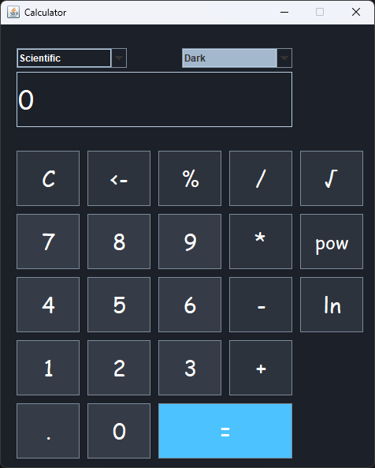
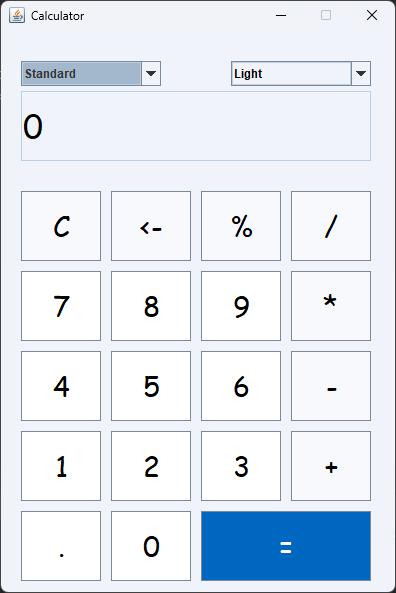

# Calculator
A very basic calculator application created using Java **Swing**. 

## Thank You!
Please ⭐️ this repo and share it with others

## Screenshots
|                Scientific / Dark                | Standard / Colored |
:------------------------------------------------:|:-------------------|
  | 

## Requirements 🔧
* Java 11 or higher.

## Installation 🔌
1. Press the **Fork** button (top right the page) to save copy of this project on your account.

2. Download the repository files (project) from the download section or clone this project by typing in the bash the following command:

       git clone https://github.com/HouariZegai/Calculator.git
3. Imported it in Intellij IDEA or any other Java IDE.
4. Run the application :D

## Contributing 💡
If you want to contribute to this project and make it better with new ideas, your pull request is very welcomed.
If you find any issue just put it in the repository issue section, thank you.

---

## CCSW 413 – Software Design Patterns Project

This fork refactors the calculator using design patterns (University of Jeddah, CCSW 413).

| Stage | Category | Pattern | Where in the code |
|---|---|---|---|
| 1 | Creational | **Singleton** | `theme/ThemeLoader` – one shared instance, themes read from the YAML file once |
| 1 | Creational | **Factory Method** | `ui/button/ButtonCreator` + `NumberButtonCreator`, `OperatorButtonCreator`, `EqualButtonCreator`, `ScientificButtonCreator` |
| 2 | Structural | **Adapter** | `theme/ColorScheme` (target) + `theme/ThemeColorAdapter` (adapter) wrapping `Theme` (adaptee) |
| 2 | Structural | **Composite** | `ui/component/CalculatorComponent`, `KeyComponent`, `FieldComponent` (leaves), `ComponentGroup` (composite) |

Git tags: `original`, `stage-1`, `stage-2`.

**Team:** Abdulaziz Almalki, Abdulelah Alzahrani, Reda Alamoudi

**Credits:** based on [HouariZegai/Calculator](https://github.com/HouariZegai/Calculator) by Houari Zegai, MIT licence (see `LICENSE`).

**Verification:** the original test cases in `CalculatorUITest` (+, -, *, /, %, ^) pass 6/6 on the Stage 2 code.
